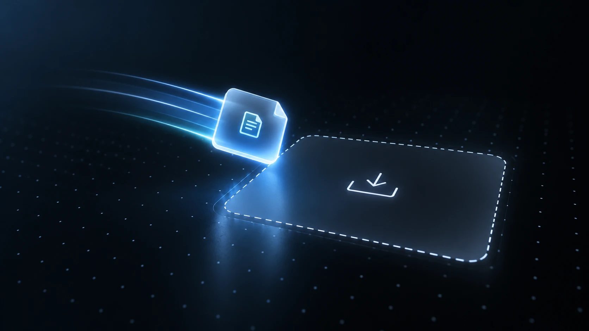

<div align="center">


# Moder Viewer

**Drop a 3D model. Look at it from every angle. Nothing leaves your browser.**

[**Open the live demo →**](https://zalaya.github.io/moder-viewer/)

[](https://github.com/zalaya/moder-viewer/actions/workflows/deploy.yml)
[](LICENSE)

</div>

## Try it in ten seconds

No install, no account, no upload. Open the demo, drop a `.glb` or a `.gltf` package anywhere on the page and start orbiting. A GLTF package can include its `.bin` and texture files. No model at hand? Pick one of the samples.



## Private by design

Your model is parsed and rendered locally in the browser. There is no server, so there is nothing to upload and nothing to leak. Once the page has loaded, it needs no network.


## See what's inside

Switch to wireframe, toggle the grid, auto-rotate, and read the numbers that matter: vertices, triangles, meshes, materials, textures, animations, dimensions and file size. Animated models play right away, with controls for selecting a clip, pausing and changing speed.


## Eight samples to start with

A steel torus knot, a crystal, an animated gyroscope, a low-poly tree, a damaged helmet, a robot companion, a scout drone and an energy sword: one click each from the start screen.


## Made to be played with

A dock that magnifies like macOS, and a shortcut for everything.


`G` grid · `W` wireframe · `R` auto-rotate · `I` info · `F` reset camera · `S` screenshot

Models are processed locally and are limited to 250 MB per load. For a multi-file `.gltf`, select or drop the `.gltf` file together with its `.bin` and texture dependencies.

## Run it yourself

```bash
bun install
bun run development
```

Built with React, TypeScript, Vite, Tailwind CSS and Three.js through React Three Fiber.

## License

[MIT](LICENSE)
