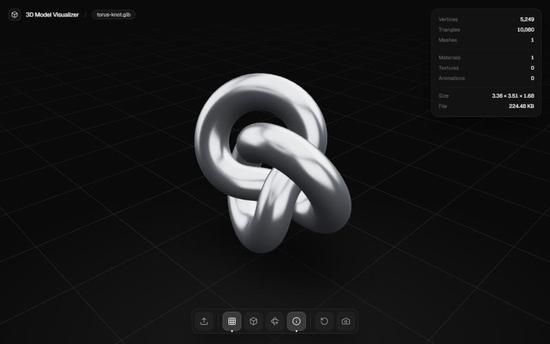
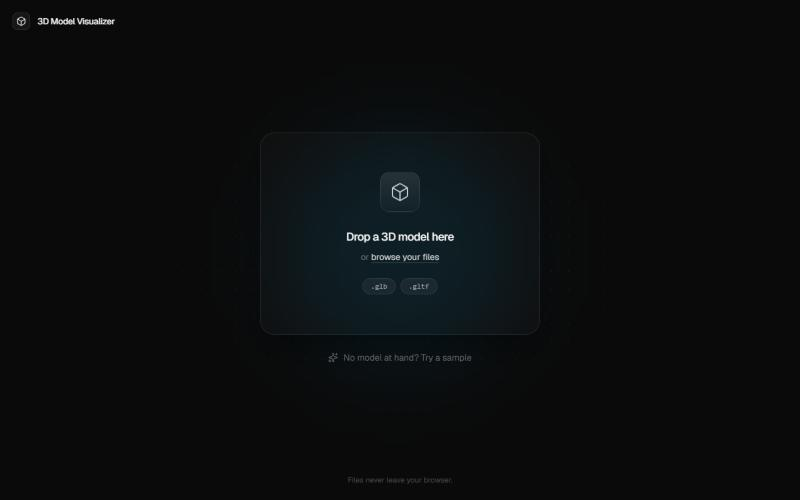
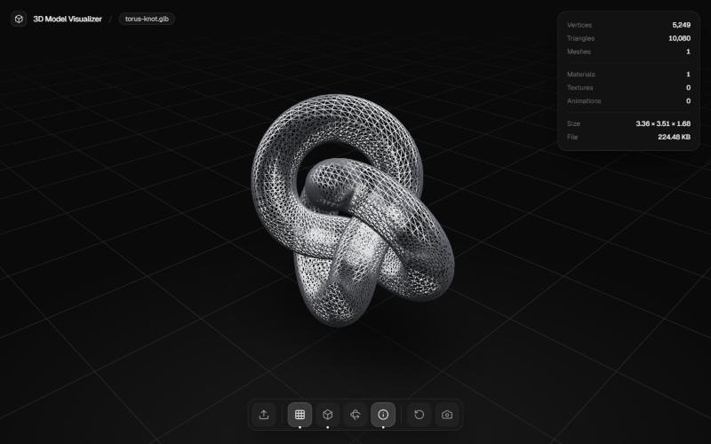
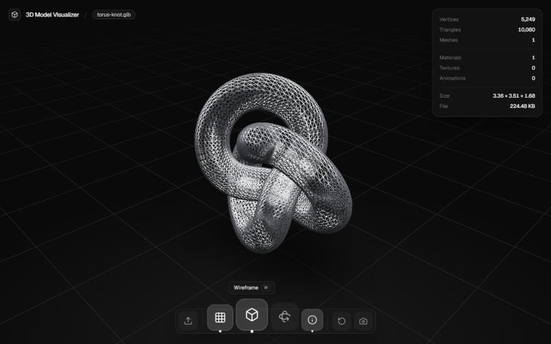

# 3D Model Visualizer

[](https://github.com/zalaya/3d-model-visualizer/actions/workflows/deploy.yml)
[](LICENSE)

Inspect `.glb` and `.gltf` models in your browser. Drop a file and look at it from every angle, see its stats and take a screenshot. Everything runs locally: **nothing is uploaded**.

**[Live demo](https://zalaya.github.io/3d-model-visualizer/)**: no model at hand? Hit *Try a sample*.



## Features

- Drag & drop anywhere on the page, or pick a file
- Orbit, pan and zoom, auto-rotate and one-key camera reset
- Grid, wireframe and ground shadows
- Model stats: vertices, triangles, meshes, materials, textures, animations, dimensions and file size
- First animation plays automatically
- PNG screenshot of the current view
- Keyboard shortcuts for every action
- Clear errors for unsupported, corrupt or empty files

| Start | Wireframe |
| --- | --- |
|  |  |

## Using it

| Key | Action |
| --- | --- |
| `O` | Open another file |
| `G` | Toggle grid |
| `W` | Toggle wireframe |
| `R` | Toggle auto-rotate |
| `I` | Toggle model info |
| `F` | Reset camera |
| `S` | Save a screenshot |

The dock at the bottom shows the same actions; hover it and the icons magnify like a macOS dock, with the shortcut in the tooltip.



## How it works

1. **Loading.** A file is validated by extension and turned into an object URL. Nothing leaves the browser.
2. **Parsing.** `useGLTF` from drei parses the file inside a React Three Fiber canvas. The viewer, and with it Three.js, is lazy-loaded the first time a model is opened, so the first screen stays around 230 kB.
3. **Analysis.** `analyzeScene` walks the scene once to count vertices, triangles, meshes, materials and textures, measures the bounding box and works out a uniform scale and offset. Every model ends up the same size and resting on the floor, whether it's a coin or a building.
4. **Rendering.** The model is lit by an environment made of procedural light panels (no HDR to download, so it works offline), with contact shadows, an optional grid and orbit controls.
5. **Cleanup.** When a model is replaced its object URL is revoked and its geometries, materials and textures are disposed so GPU memory doesn't pile up.
6. **Failures.** An error boundary around the model catches loader errors and empty files and shows the reason in a toast instead of crashing.

## Stack

React 19, TypeScript (strict), Vite, Tailwind CSS 4, Three.js with React Three Fiber and drei. Linted with ESLint (typescript-eslint parser and `simple-import-sort`).

## Running it locally

```bash
bun install
bun run development
```

| Script | What it does |
| --- | --- |
| `development` | Vite dev server |
| `build` | Type-check and production build |
| `production` | Preview the production build |
| `typecheck` | `tsc` |
| `lint` | ESLint |
| `check` | Type-check and lint |
| `format` | `eslint --fix` |

## Architecture

```
source/
├── App.tsx               Composes the features
├── features/
│   ├── model-loader/     Getting a file in: picker, drag & drop, sample, validation, errors
│   └── viewer/           Rendering and inspecting it
│       ├── components/   UI and R3F components
│       ├── hooks/        Settings state, dock actions and dock magnification
│       ├── helpers/      Pure functions: scene analysis, camera, disposal, screenshot
│       ├── constants.ts
│       └── types.ts
└── shared/               Components, hooks and helpers used by more than one feature
```

- Features expose a public API through their `index.ts`; ESLint rejects imports of their internals from outside.
- Dependencies point one way: `App → features → shared`.
- Logic that doesn't need React lives in `helpers/` as plain functions.

## Deployment

Every push to `main` runs [`deploy.yml`](.github/workflows/deploy.yml): type-check, lint, build and publish `dist/` to GitHub Pages. Pull requests run [`ci.yml`](.github/workflows/ci.yml). The build uses relative asset paths, so it works under any repository name.

To enable it on a fork: *Settings → Pages → Build and deployment → Source: GitHub Actions*.

## Contributing

Issues and pull requests are welcome; see [CONTRIBUTING.md](CONTRIBUTING.md) and the [Code of Conduct](CODE_OF_CONDUCT.md). Security reports go through [SECURITY.md](SECURITY.md).

## License

[MIT](LICENSE)
